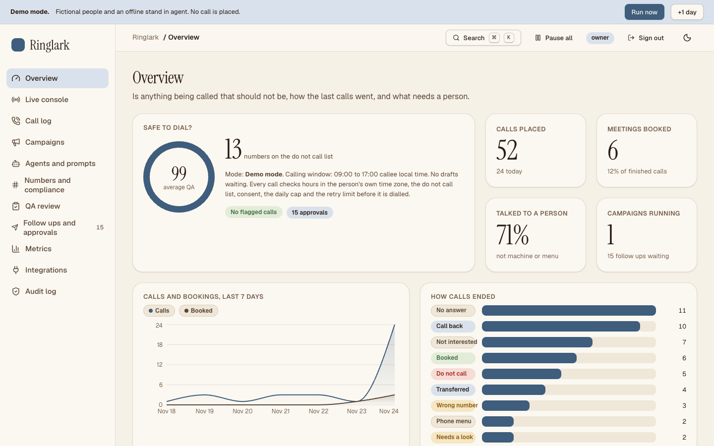
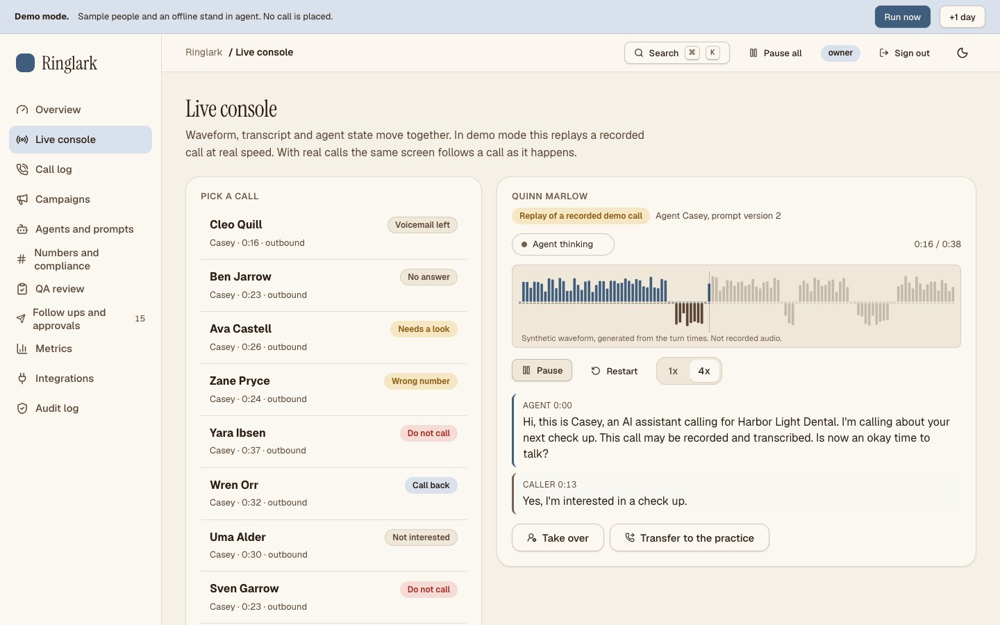
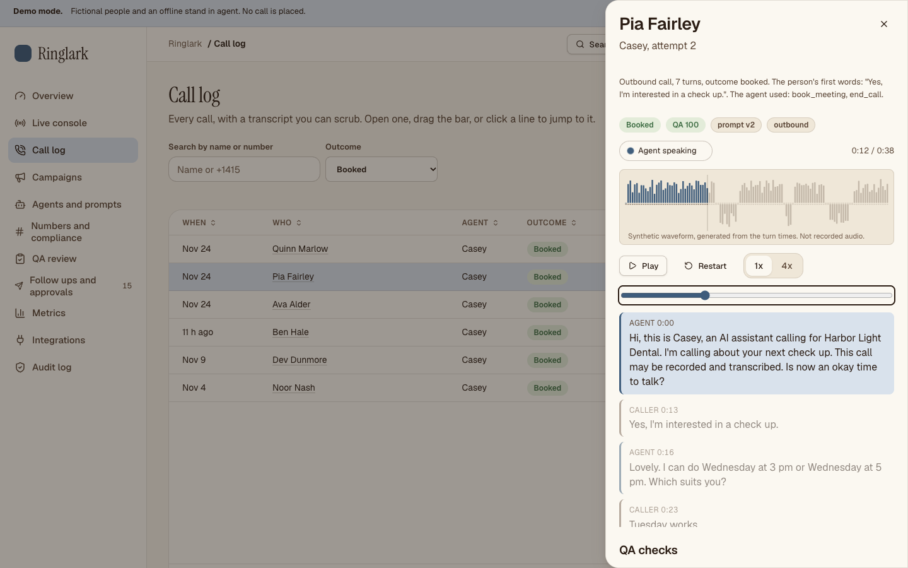

# Ringlark

Ringlark helps you set up an AI phone caller that books meetings, for inbound and outbound calls, with follow ups after each call. It starts in a safe draft mode where no call or text is made, so you can try it on invented data in about 10 minutes. It is a setup system, not a hosted voice platform: the voice engine is Ultravox and the phone numbers are Telnyx.

## What it does

- Checks a chain of rules before every call: kill switch, AI disclosure, number format, do not call list, consent, calling hours in the person's own time zone, daily cap, tries per person, gap between tries.
- Keeps versioned agent prompts with a compare view and a split test, a text simulator, and a persona suite of 14 scripted callers with an answer key and an honest score.
- Gives the agent tools during a call: book a meeting, look up the CRM, transfer to a person, send a text, press a key in a phone menu, end the call with a result code.
- After each call: transcript, summary, result code, QA score, follow ups that wait for approval, a CRM note.
- A live call console and a call scrubber, a tamper evident audit log and a kill switch.

| Live console | Call scrubber |
|---|---|
|  |  |

## Try it

Follow [docs/01-QUICK-DEMO.md](docs/01-QUICK-DEMO.md). Everything in the demo is fictional and nothing leaves your computer. The demo password only works while `DEMO_MODE=true`.

## Use it for real

Start at [docs/00-START-HERE.md](docs/00-START-HERE.md). The guides run from `00` to `15`: business basics, connecting tools, settings, running locally, deploying (Vercel, Railway, Hetzner), a go live checklist, operating, updating, security, limits and troubleshooting. Reference: [architecture](docs/ARCHITECTURE.md), [capabilities](docs/CAPABILITIES.md), [tools and alternatives](docs/TOOLS-AND-ALTERNATIVES.md), [voice options](docs/VOICE-OPTIONS.md), [US calling checklist](docs/US-CALLING-CHECKLIST.md), [persona suite](docs/PERSONA-SUITE-EVAL.md), [prompt writing](docs/PROMPT-WRITING-GUIDE.md), [glossary](docs/GLOSSARY.md), [facts and sources](docs/FACTS-AND-SOURCES.md).

## What was measured

Numbers come from `data/counts.json`, `data/measured.json` and the runs on 2026-11-23 (the Python test and coverage numbers were measured again on 2026-11-25 for version 1.0.1).

- <!--n:tests.passed-->314<!--/n--> Python tests passed, <!--n:tests.skipped-->1<!--/n--> skipped (the Postgres cycle), <!--n:tests.coverage_percent-->91<!--/n--> percent line coverage of the `ringlark` package (measured by `tools/make_counts.py`, quoted from `data/measured.json`). <!--n:contract_tests-->12<!--/n--> of the tests are contract tests against saved excerpts of the vendors' public docs (`mock/contracts`).
- Compliance property tests on thousands of seeded random worlds: the dialer never called outside the person's hours, never called a do not call or revoked consent number, never went over the cap.
- Database migrations up, down and up again on SQLite and on Postgres 17.7.
- A fresh clone in a temporary folder is installed from nothing, built, tested and run through all the browser tests, then deleted (the last run is in `docs/14-LIMITS-AND-HONEST-NOTES.md`).
- <!--n:browser_tests-->39<!--/n--> browser tests in Chrome: the whole demo path, a CSV upload, accessibility scans of all 11 pages in light and dark (0 serious or critical problems), keyboard use, reduced motion, 5,000 call rows, no layout shift, no console errors.
- The seed check (`python tools/score_seed.py`): 7 kinds of planted problems (19 rows), all held back.
- How well it reads callers it has never seen, on two independent test sets written by authors who never saw the code (rules, not a language model): first run on set A <!--n:reader.set_a_first.strict-->65<!--/n--> of <!--n:reader.set_a_first.lines-->135<!--/n--> lines, first run on set B <!--n:reader.set_b_first.strict-->83<!--/n--> of <!--n:reader.set_b_first.lines-->137<!--/n-->. A stop request is the number that matters most: see [docs/CALLER-READER-EVAL.md](docs/CALLER-READER-EVAL.md).
- The persona suite uses an offline rule based agent, not a language model. Held out set 2, first run: **7 of 14**. Held out set 1, first run: 12 of 14, then tuned. Dev set: 14 of 14 (tuned against). See [docs/PERSONA-SUITE-EVAL.md](docs/PERSONA-SUITE-EVAL.md).

## Honest limits

No adapter has been run against a real service. The way a Telnyx call joins an Ultravox call was written from the docs and never run live: it is the most likely thing to need a fix on your first test call. The agent in the demo is a set of rules, not a language model. Nobody who built this can hear a voice, so you judge the voice on a real test call. The CI workflow builds the Docker images and starts the compose stack on GitHub, but nothing was deployed to a real host (the three hosting guides were not followed on a real account). On a live call the safety rules are in the voice model's prompt, not in code that listens to the call (see [docs/13-SECURITY-AND-DATA.md](docs/13-SECURITY-AND-DATA.md)). This is not legal advice about AI voice calls, consent or recording. Read [docs/14-LIMITS-AND-HONEST-NOTES.md](docs/14-LIMITS-AND-HONEST-NOTES.md) before real use.

## Layout

`apps/api` API and worker, `apps/web` dashboard, `mock` fake vendor servers, `data` demo data and test sets, `tools` helper commands, `docs` guides, `packages` shared frozen base, `deploy` hosting files, `prompts` and `templates` for Claude Code, Codex, ChatGPT and Claude.

## Licence

MIT. See [LICENSE](LICENSE).
